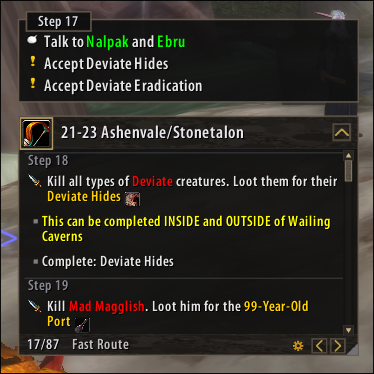

# TurtleGuides

Leveling guide addon for Turtle WoW 1.12.1.

## Preview



## Guide syntax

The parser supports the common RXP-style guide syntax: `.goto`, `.accept`, `.complete`, `.turnin`, `>>` notes, and color tokens. Bundled routes are adapted from RestedXP's free classic guides (RXPGuides, CC BY-NC-SA 4.0) and are shared under that same licence. See `THIRD_PARTY_LICENSES.txt`. You can use your own guide files, or licensed guides you already have locally, with the same syntax.

## Install

Copy the `TurtleGuides` folder into your `Interface\AddOns` directory.

## Development

Tool versions are pinned in `mise.toml`.

```sh
mise install
mise run check
```

See `docs/ARCHITECTURE.md` for the runtime model and package layout, and `CONTRIBUTING.md` for conventions.

## License

Addon code is GPL-3.0-only. Bundled guide data derived from RXPGuides is CC BY-NC-SA 4.0. Copyright (C) 2026 NickW16 and Vittv. See `LICENSE`, `NOTICE`, and `THIRD_PARTY_LICENSES.txt`.
